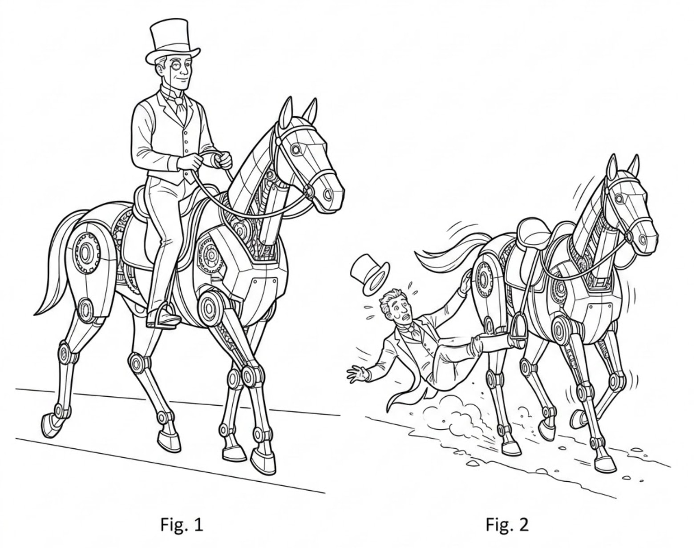
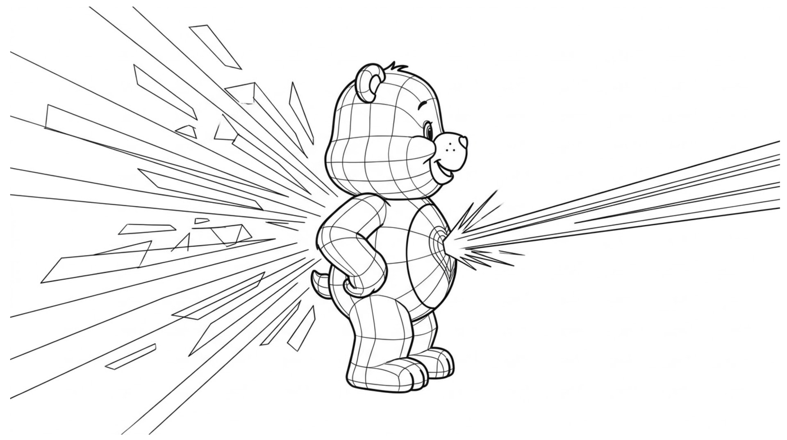
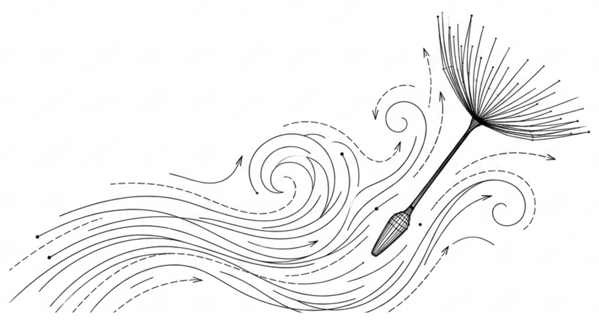

A couple of thoughts that came up in conversations I recently had about AI. 

## AI makes work more difficult

If you feel like your work became easier with AI, you're probably doing something wrong.
With AI, your work should now feel much harder than before. You need to reason more frequently and more deeply in order to drive AI.
You need to make a cognitive switch to the point that it is clear to yourself and your peers that you bring added value on top of AI.

## Sit on the saddle

If AI is a horse, then you should be riding on the saddle.
Sometimes AI drags you on the dirt by the stirrup, but you should be mindful of when that happens, and try to regain the saddle.

## You are a filter

You are a filter. Your value as a human employee is the value of your filter.
Reality and work bring a ton of inputs, from which you produce outputs. The filter -- you -- is in between.
You experience it in every exchange with humans and AI.
Your fellow humans notice when your filter is valuable and when it is not.

## Nodes are human, edges are agentic

If product evolution is a graph, then defining nodes is human activity, and producing the edges that lead from one node to another may be agentic.
We already know that AI can produce reasonably good edges.
It is the nodes where human value lies.
Sometimes AI can produce the nodes reasonably well too. In such cases you should seek to invest your talent in more difficult problems.

## Occam's razor is more relevant than ever

AI is likely going to tell you that you need a web server with an `/api` endpoint, and that it should be written in go.
The human in the loop should be restless in stripping bloat until there is nothing left to strip.
We should drive AI to produce less code, not more.

## Do not tumble rootless

With AI at hand it's easy to resort to superficial treatment.
Jumping around without building depth is dangerous.
You should invest in fundamentals and first principles.
With AI, the depth of your deep dive is limited by your curiosity.
If you bottom out too soon, you're like a seed that tumbles in the wind and that never roots.

